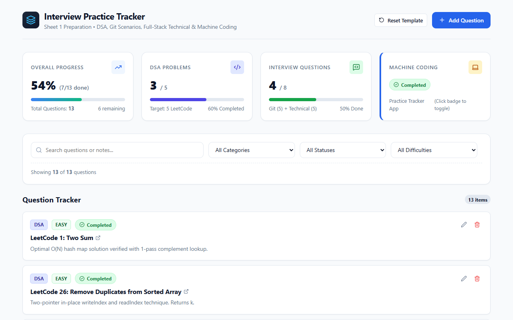
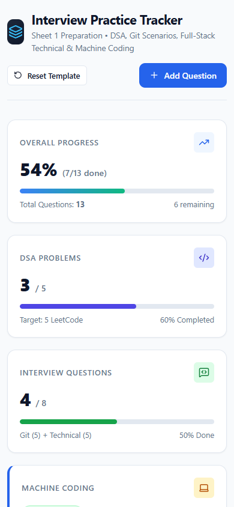

# Interview Practice Tracker

[](https://react.dev/)
[](https://vitejs.dev/)
[](./test_logic.js)
[](LICENSE)

A responsive single-page application built to track and optimize interview preparation across **Data Structures & Algorithms (DSA)**, **Git & GitHub Scenarios**, **Full-Stack Technical Interview Topics**, and **Machine Coding Milestones**.

---

## 🔗 Live Application & Demo

- **Live Deployment:** *[Deploy to Vercel / Live URL Placeholder]*
- **1–2 Minute Video Demo:** *[Loom / YouTube / Google Drive Demo Link Placeholder]*

---

## 📸 Interface Previews

### Desktop Dashboard View (1280 × 800)


### Mobile Responsive View (390 × 844)


---

## 🌟 Key Features

### 1. Real-Time Metrics & Visual Progress Dashboard
- **Overall Completion Percentage:** Automatically calculated from active stored questions.
- **DSA Problem Tracker:** Tracks progress against key LeetCode problems (e.g. Two Sum, Remove Duplicates, Move Zeroes, Rotate Array, 3Sum).
- **Interview Topics Counter:** Tracks mastery across Git workflow scenarios and Full-Stack technical interview topics.
- **Machine Coding Milestone:** Interactive toggle card indicating the implementation state of the project itself.

### 2. Multi-Parameter Search & Filtering
- **Instant Search:** Debounce-free client search across both question titles and approach notes.
- **Category Filter:** Filter by `DSA`, `Git`, or `Technical`.
- **Status Filter:** Filter by `Pending`, `In Progress`, or `Completed`.
- **Difficulty Filter:** Filter by `Easy`, `Medium`, or `Hard`.
- **Clear Filters Action:** One-click reset when any filter combinations yield zero results.

### 3. Question Lifecycle & Form Validation
- **Add / Edit Modal:** Accessible modal dialog with keyboard escape handling (`Esc`) and autofocus.
- **Robust Form Validation:**
  - Mandatory title with a minimum 3-character requirement.
  - Optional documentation/LeetCode URL with strict URL format validation.
  - Category, difficulty, and status selection.
- **Quick Status Toggle:** Direct cycling of status chips (`Pending` $\rightarrow$ `In Progress` $\rightarrow$ `Completed`) directly on cards without opening the full edit modal.
- **Safe Deletion:** Deletion confirmation prevents accidental data loss.

### 4. Persistence & State Management
- **LocalStorage Synchronization:** Automatic, non-blocking synchronization of questions and machine-coding milestone to browser `localStorage`.
- **Syllabus Pre-seeding:** Comes preloaded with 13 official interview preparation questions and notes.
- **Reset Template Option:** One-click reset to restore the original syllabus.

### 5. Responsive Design & Accessibility
- Clean typography and color-coded chips for categories, difficulties, and statuses.
- Fully responsive across desktop, tablet, and mobile devices (stacked layout and touch-friendly controls).
- Zero external CSS libraries or bloated UI kits; built with an ultra-fast custom CSS design system.

---

## 🛠️ Tech Stack & Architecture

- **Framework:** React 19
- **Bundler:** Vite 8
- **Icons:** Lucide React (`lucide-react`)
- **Styling:** Custom CSS Design Tokens (`src/index.css`) with responsive CSS Grid & Flexbox
- **Persistence:** Browser `localStorage` API
- **Testing:** Custom zero-dependency test runner (`test_logic.js`) + Headless Chromium suite (`browser_test.js`)

---

## 🚀 Getting Started Locally

### Prerequisites
- [Node.js](https://nodejs.org/) (v18 or higher recommended; verified on Node v24)
- npm (v9 or higher)

### Installation & Run

```bash
# 1. Clone the repository
git clone https://github.com/JahnvviJha/practice-tracker.git
cd practice-tracker

# 2. Install dependencies
npm install

# 3. Start local development server
npm run dev
```

Open [http://localhost:5173](http://localhost:5173) in your browser.

---

## 🧪 Testing & Verification

### 1. Unit & Logic Tests (Fast, Zero Dependencies)
Runs 18 unit tests validating calculation accuracy, multi-parameter filtering permutations, form validation rules, and status transitions:
```bash
npm test
```

### 2. Real Browser Integration Tests
Runs an automated headless Chrome/Chromium suite with 19 assertions validating initial load, desktop/mobile screenshots, form validation errors, item additions, status toggling, search, filtering, and LocalStorage persistence across page reloads:
```bash
# Prerequisites: Vite dev server running at http://localhost:5173, Chrome or Edge installed
npm run test:browser
```
*(Optional: set `CHROME_BIN` if your browser is in a non-standard location).*

### 3. Production Build
```bash
npm run build
```
Creates an optimized, production-ready static bundle inside the `dist/` directory in under 2 seconds.

---

## 🌐 Deployment Instructions

### Deploy to Vercel (Recommended — Zero Configuration)
1. Push this repository to GitHub.
2. Go to [vercel.com](https://vercel.com) and click **"Add New Project"**.
3. Import this repository.
4. Framework Preset: **Vite** | Root Directory: `./` | Build Command: `npm run build` | Output Directory: `dist`.
5. Click **Deploy**. Your live URL will be generated instantly.

### Deploy to GitHub Pages
1. Install `gh-pages`: `npm install -D gh-pages`
2. Add `"homepage": "https://<your-username>.github.io/<repo-name>"` in `package.json`.
3. In `vite.config.js`, set `base: '/<repo-name>/'`.
4. Run: `npm run build && npx gh-pages -d dist`.

---

## 📋 Architectural Decisions & Assumptions

1. **Client-Side Only (No Backend Required):**
   - Built to strictly adhere to the project requirements without a backend.
   - `localStorage` is used as the single source of truth, giving instantaneous reads/writes without network latency.
2. **Focused Feature Scope:**
   - Adhered strictly to the 2.5-hour machine coding time limit.
   - Focused on core workflow requirements (dashboard stats, search/filter, CRUD operations, persistence, validation, responsiveness) rather than bloated dependencies or unnecessary abstractions.

---

## 📄 License
MIT License. Free to use for study and interview preparation.
